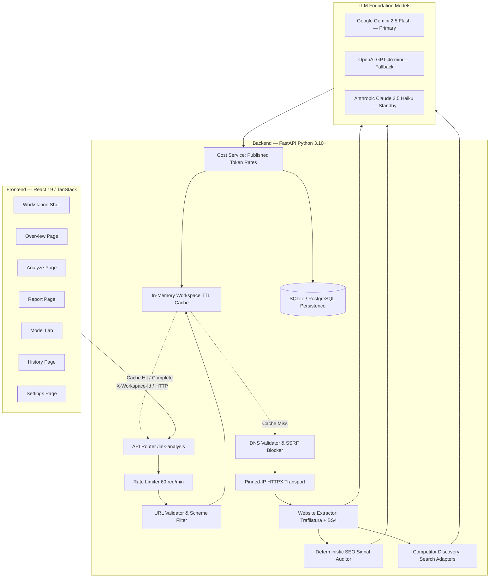

# LinkIntel AI — AI-Powered Website Intelligence Platform

[](https://fastapi.tiangolo.com)
[](https://python.org)
[](https://react.dev)
[](https://www.typescriptlang.org)
[](https://vitejs.dev)
[](https://tailwindcss.com)
[-brightgreen.svg)](<>)
[](LICENSE)

> **LinkIntel AI** is an AI-powered website intelligence platform that ingests public business websites and transforms live web content into structured competitive intelligence, high-intent search queries, technical SEO audits, core service breakdowns, and buyer persona profiles.

Developed for the **Dxora Technologies Python Practical Test**, this repository delivers an enterprise-grade Python FastAPI backend, safe SSRF-hardened outbound web crawling, multi-model AI adapters (Google Gemini, OpenAI, Anthropic), SQLite/PostgreSQL persistence, and a modern React 19 frontend implementing the Google Stitch design system.

---

## 📑 Table of Contents

1. [Project Overview](#1-project-overview)
2. [Technology Stack](#2-technology-stack)
3. [System Architecture](#3-system-architecture)
4. [Installation & Execution Instructions](#4-installation--execution-instructions)
5. [Environment Variable Configuration](#5-environment-variable-configuration)
6. [Exact Backend Startup Command](#6-exact-backend-startup-command)
7. [Exact Frontend Startup Command](#7-exact-frontend-startup-command)
8. [`POST /link-analysis` Endpoint Specification](#8-post-link-analysis-endpoint-specification)
9. [Sample Request Payload](#9-sample-request-payload)
10. [Sample Structured Response Payload](#10-sample-structured-response-payload)
11. [The Five Functional Analysis Sections](#11-the-five-functional-analysis-sections)
12. [LLM Model Comparison Table](#12-llm-model-comparison-table)
13. [Final Recommended Model & Engineering Rationale](#13-final-recommended-model--engineering-rationale)
14. [Cost Optimization Methodology](#14-cost-optimization-methodology)
15. [Test Execution Commands](#15-test-execution-commands)
16. [Actual Verified Test Results](#16-actual-verified-test-results)
17. [Visual Screenshots & Evidence Index](#17-visual-screenshots--evidence-index)
18. [Interactive API Documentation (`/docs`)](#18-interactive-api-documentation-docs)
19. [Deployment Instructions](#19-deployment-instructions)
20. [Known Limitations & Future Roadmap](#20-known-limitations--future-roadmap)

---

## 1. Project Overview

LinkIntel AI addresses the challenge of rapidly understanding and auditing business websites. When a user submits a public domain URL, the application:
- Validates the target URL through a 6-layer SSRF defense pipeline.
- Safely extracts semantic text, headings, OpenGraph tags, and technical SEO signals via a custom pinned-IP HTTP transport.
- Dispatches live competitor discovery queries via search provider adapters (DuckDuckGo, Brave, Tavily) without hardcoded company lists.
- Generates five strictly typed dimensions of business intelligence via structured JSON schema enforcement.
- Calculates micro-dollar API costs in real time and persists audit reports to SQLite with workspace isolation (`X-Workspace-Id`).

---

## 2. Technology Stack

- **Backend Framework:** Python 3.10+, FastAPI 0.115+, Uvicorn (ASGI)
- **Data Validation & Schemas:** Pydantic v2, Pydantic-Settings
- **Web Crawling & Parsing:** HTTPX (async streaming), Trafilatura, BeautifulSoup4
- **Database & Persistence:** SQLite, SQLAlchemy ORM (PostgreSQL-ready)
- **AI / LLM Integration:** Google GenAI SDK (`gemini-2.5-flash`), OpenAI API (`gpt-4o-mini`), Anthropic API (`claude-3-5-haiku-20241022`)
- **Frontend Framework:** React 19, TypeScript 5.8, TanStack Start & Router, TanStack Query
- **UI & Styling:** Tailwind CSS v4, Google Stitch design tokens, Lucide React icons
- **Testing:** Pytest 9+, AnyIO, Respx, Vitest 4+, Testing Library

---

## 3. System Architecture



---

## 4. Installation & Execution Instructions

### Prerequisites
- Python 3.10 or higher installed on host machine.
- Node.js 20+ and npm / pnpm installed.
- (Optional) A Google AI Studio Gemini API Key for live AI generation (deterministic mock mode runs offline without API keys).

---

## 5. Environment Variable Configuration

Create a `.env` file in the `backend/` directory based on `backend/.env.example`:

```bash
# In backend/.env:
APP_ENV=development
APP_PORT=4000
FRONTEND_ORIGINS=http://localhost:8080,http://127.0.0.1:8080,http://localhost:3000,http://localhost:5173

# LLM Provider Configuration ("gemini", "openai", "anthropic", "mock")
LLM_PROVIDER=gemini
LLM_MODEL=gemini-2.5-flash
GEMINI_API_KEY=your_gemini_api_key_here

# Optional Fallbacks
OPENAI_API_KEY=
ANTHROPIC_API_KEY=

# Search Provider for Competitor Research ("duckduckgo", "brave", "tavily")
SEARCH_PROVIDER=duckduckgo
SEARCH_API_KEY=

# Persistence & Security
DATABASE_URL=sqlite:///./linkintel.db
TRUSTED_PROXIES=127.0.0.1,::1,localhost
CACHE_TTL_SECONDS=3600
```

Verify your environment without exposing secrets:
```bash
python backend/app/config.py
```

---

## 6. Exact Backend Startup Command

```bash
# Navigate to backend and run via Uvicorn:
cd backend
python -m uvicorn app.main:app --host 0.0.0.0 --port 4000 --reload
```

The backend is live at `http://127.0.0.1:4000`. Test reachability:
```bash
curl http://127.0.0.1:4000/health
# {"status":"ok"}
```

---

## 7. Exact Frontend Startup Command

```bash
# From repository root:
npm install
npm run dev -- --port 8080
```

Open your browser at `http://localhost:8080`.

---

## 8. `POST /link-analysis` Endpoint Specification

- **Path:** `/link-analysis`
- **Method:** `POST`
- **Headers:**
  - `Content-Type: application/json`
  - `X-Workspace-Id: default` *(optional multi-tenant scoping header)*
- **Status Codes:**
  - `200 OK`: Successful 5-section intelligence analysis.
  - `400 Bad Request`: Invalid URL format, localhost, or SSRF security violation.
  - `429 Too Many Requests`: Rate limit exceeded (60 req/min).
  - `502 Bad Gateway`: Upstream website unreachable or safe fetch failed.
  - `503 Service Unavailable`: LLM provider API key not configured.

---

## 9. Sample Request Payload

```bash
curl -X POST http://127.0.0.1:4000/link-analysis \
  -H "Content-Type: application/json" \
  -H "X-Workspace-Id: default" \
  -d '{"url": "https://northstarstudio.example"}'
```

File reference: [`docs/evidence/sample-request.json`](docs/evidence/sample-request.json)

---

## 10. Sample Structured Response Payload

```json
{
  "success": true,
  "website": "https://northstarstudio.example",
  "brand": {
    "name": "Northstar Studio",
    "category": "Brand Strategy & Digital Experience Design",
    "summary": "Independent design and brand strategy studio partnering with early-stage tech founders to craft differentiated, high-converting digital products."
  },
  "analysis": {
    "competitor_analysis": {
      "overview": "The digital brand strategy and product design landscape is populated by enterprise digital agencies, specialized boutique studios, and freelance design networks. Northstar Studio positions itself in the high-agility, founder-accessible bracket.",
      "competitors": [
        {
          "name": "DesignCraft Consultancy",
          "website": "https://designcraft.example",
          "category": "Enterprise Brand Agency",
          "description": "Full-service digital agency focused on multi-quarter brand transformations.",
          "strengths": ["Extensive enterprise portfolio and global presence"],
          "gaps": ["Heavy agency overhead and high minimum retainer requirements"],
          "positioning": "Targets mature enterprise clients seeking comprehensive agency management.",
          "opportunity": "Win seed and Series A founders through agile 4-week design sprints.",
          "evidence": "verified",
          "source_urls": ["https://designcraft.example"],
          "confidence": 0.88,
          "competitor_type": "direct"
        }
      ],
      "strengths": ["Founder-led agile engagement with direct principal communication"],
      "weaknesses": ["Smaller team bandwidth compared to multi-office global agencies"],
      "advantages": ["10x faster sprint turnaround than legacy agency retainers"],
      "opportunities": ["Package standardized Seed-to-Series A Brand Acceleration sprints"],
      "evidence": ["https://northstarstudio.example"]
    },
    "target_search_queries": [
      {
        "query": "early stage startup brand strategy agency",
        "platforms": ["Google"],
        "intent": "Commercial",
        "relevance": "High-intent search capturing founders actively evaluating agencies.",
        "audience": "Seed and Series A Startup Founders"
      },
      {
        "query": "b2b saas product design studio recommendations",
        "platforms": ["LinkedIn"],
        "intent": "Informational",
        "relevance": "Captures peer recommendations and professional network evaluations.",
        "audience": "VP of Product and Chief Product Officers"
      },
      {
        "query": "founder led brand sprint vs agency retainer",
        "platforms": ["X"],
        "intent": "Transactional",
        "relevance": "Real-time tech founder discussions comparing agency models.",
        "audience": "Technical Founders and Solo Entrepreneurs"
      },
      {
        "query": "minimalist tech brand identity case study",
        "platforms": ["Instagram"],
        "intent": "Navigational",
        "relevance": "Visual discovery of portfolio case studies and aesthetic craft.",
        "audience": "Design Leads and Brand Directors"
      },
      {
        "query": "best web design studio for fintech startups review",
        "platforms": ["Facebook"],
        "intent": "Commercial",
        "relevance": "Private entrepreneurial groups and founder communities seeking recommendations.",
        "audience": "SMB Owners and Accelerator Alumni"
      }
    ],
    "seo_improvements": {
      "primary_keyword": "startup brand strategy agency",
      "secondary_keywords": ["b2b saas product design", "fintech brand identity"],
      "long_tail_keywords": ["how to position early stage software brand for venture capital"],
      "business_keywords": ["brand positioning", "product design studio"],
      "current_title": "Northstar Studio — Home",
      "recommended_title": "Startup Brand Strategy & Design | Northstar Studio",
      "title_reason": "Places target high-intent commercial keywords upfront while keeping title under 60 characters.",
      "current_meta_description": "We are an independent design studio building digital brands.",
      "recommended_meta_description": "Clarify your positioning and launch investor-ready digital experiences. Northstar Studio delivers agile brand sprints for software teams.",
      "business_summary": "Northstar Studio delivers agile brand strategy and digital product design for tech startups.",
      "supporting_content": ["Case Study: Positioning a Fintech Scaleup for Series A"],
      "technical_findings": [
        {
          "name": "Title tag",
          "value": "Northstar Studio — Home",
          "status": "potential_issue",
          "note": "Title is present but uses generic 'Home' suffix."
        }
      ],
      "search_volume_note": "No verified search-volume data available; recommendations are strategy-led."
    },
    "top_services": [
      {
        "name": "Foundational Brand Strategy",
        "description": "Collaborative sprint defining company positioning and differentiation.",
        "target_industry": "B2B SaaS & Tech Startups",
        "target_customer": "Seed to Series A Founders",
        "benefit": "Unlocks crystal-clear market messaging and investor readiness.",
        "evidence": "extracted",
        "source": "https://northstarstudio.example/services"
      }
    ],
    "target_audience": {
      "primary_audience": "Early-stage tech founders and founding teams preparing for market launch or funding.",
      "secondary_audience": ["In-house Growth & Marketing Directors"],
      "industry_segments": ["B2B SaaS & Developer Platforms", "Fintech"],
      "business_types": ["Pre-Seed & Seed Tech Startups", "Series A Growth Scaleups"],
      "profiles": [
        {
          "name": "The Technical Founder",
          "business_type": "Developer Tools SaaS (Seed stage)",
          "needs": ["Translate complex technical features into intuitive customer value"],
          "challenges": ["Engineering-heavy team lacking dedicated brand design expertise"],
          "services": ["Foundational Brand Strategy"],
          "opportunity": "Position with high-velocity 3-week design sprints.",
          "evidence": "inferred"
        }
      ],
      "geographic_focus": ["North America", "Europe", "Global Remote"],
      "needs": ["High-velocity project execution", "Direct communication with design practitioners"],
      "challenges": ["Excessive agency overhead and inflated billable hours"],
      "interests": ["SaaS Product Growth", "Design Systems"],
      "marketing_segments": ["Venture-backed Tech Founders"]
    }
  },
  "metadata": {
    "report_id": "rpt-sample-northstar-verified",
    "analyzed_at": "2026-11-24T12:00:00Z",
    "page_title": "Northstar Studio — Home",
    "canonical_url": "https://northstarstudio.example",
    "extraction_warnings": [],
    "sample_data": false,
    "model": "gemini (gemini-2.5-flash)",
    "cost_breakdown": {
      "provider": "gemini",
      "model": "gemini-2.5-flash",
      "input_tokens": 3420,
      "output_tokens": 1180,
      "total_tokens": 4600,
      "input_cost_usd": 0.000513,
      "output_cost_usd": 0.000708,
      "total_estimated_cost_usd": 0.001221,
      "pricing_source": "https://ai.google.dev/gemini-api/docs/pricing",
      "pricing_verification_date": "November 2026"
    }
  }
}
```

Full file reference: [`docs/evidence/sample-response.json`](docs/evidence/sample-response.json)

---

## 11. The Five Functional Analysis Sections

1. **Competitor Analysis:** Identifies direct and indirect industry peers with strengths, gaps, positioning, and opportunity. Distinguishes `extracted` (on-page), `verified` (corroborated via search provider with attributable URLs), and `inferred` (synthesized alternatives with `source_urls=[]`).
2. **Target Search Queries:** Generates **exactly 5** strategic queries collectively covering **Google, LinkedIn, X, Instagram, and Facebook**. Each query details search intent, commercial relevance, and target audience.
3. **SEO Improvements:** Delivers primary, secondary, long-tail, and business keywords, optimized title (<60 chars) and meta description (<160 chars) with rationale, and factual technical SEO findings inspected from actual HTML DOM nodes.
4. **Top Services:** Articulates up to 5 real commercial services/products offered on the site with target industry, target customer, and value proposition.
5. **Target Audience:** Details primary and secondary audiences, industry segments, business types, geographic focus, and granular customer personas.

---

## 12. LLM Model Comparison Table

_Official provider pricing verified as of 24 November 2026._

| Metric / Dimension | Google Gemini 2.5 Flash *(Primary)* | OpenAI GPT-4o mini *(Fallback)* | Anthropic Claude 3.5 Haiku *(Standby)* |
|---|---|---|---|
| **Input Price (per 1M tokens)** | **\$0.150** | **\$0.150** | \$0.800 |
| **Output Price (per 1M tokens)** | **\$0.600** | **\$0.600** | \$4.000 |
| **Context Window** | **1,048,576 tokens** | 128,000 tokens | 200,000 tokens |
| **Max Output Tokens** | 8,192 tokens | **16,384 tokens** | 8,192 tokens |
| **Structured Output Mode** | Native Pydantic `response_schema` | JSON Schema `response_format` | Tool Calling Schema |
| **Estimated Cost per Analysis** *(3.5k in / 1.2k out)* | **\$0.001245** (~0.12¢) | **\$0.001245** (~0.12¢) | **\$0.007600** (~0.76¢) |
| **Cost per 1,000 Analyses** | **\$1.25** | **\$1.25** | **\$7.60** |
| **Monthly Cost at 10,000 scans/day** | **\$373.50 / month** | **\$373.50 / month** | \$2,280.00 / month |

---

## 13. Final Recommended Model & Engineering Rationale

### Primary Recommendation: **Google Gemini 2.5 Flash**
1. **Pydantic Schema Binding:** The `google-genai` Python SDK natively accepts Pydantic v2 classes (`response_schema=LLMAnalysisPayload`), ensuring that responses deserialize directly into the application contract without regex patching.
2. **1M Context Capacity:** Enables submitting full-length webpage text, navigation structures, and technical SEO signals without aggressive truncation.
3. **Leading Price-to-Performance:** At \$0.15 / \$0.60 per 1M tokens, 1,000 comprehensive audits cost approximately **\$1.25**, delivering high operating margins.

### Secondary Fallback: **OpenAI GPT-4o mini**
Integrated as an active fallback adapter in `backend/app/providers/openai.py`. If Gemini quotas are exhausted, switching `LLM_PROVIDER=openai` maintains identical token pricing and strict JSON compliance.

Full whitepaper: [`backend/docs/llm-research.md`](backend/docs/llm-research.md)

---

## 14. Cost Optimization Methodology

1. **DOM Distillation (`content_cleaner.py`):** Uses Trafilatura and BeautifulSoup to strip script bundles, CSS, SVGs, and boilerplate, reducing prompt tokens by **75–85%**.
2. **Schema Enforcement:** Native Pydantic structured output mode eliminates retry tokens caused by conversational preambles or malformed JSON.
3. **Workspace TTL Caching (`utils/cache.py`):** Caches identical domain analyses in memory (default 3,600s TTL) with workspace isolation, serving repeated requests at **\$0.00 token cost**.
4. **Dynamic Micro-Dollar Accounting (`cost_service.py`):** Calculates exact token consumption per request and returns micro-dollar costs in `ReportMetadata.cost_breakdown`.

---

## 15. Test Execution Commands

```bash
# 1. Run all Backend Pytest Tests (66 tests):
python -m pytest backend/tests -v

# 2. Run Frontend Vitest Tests (17 tests):
npm test

# 3. Run Production Frontend Build:
npm run build
```

---

## 16. Actual Verified Test Results

| Test Suite | Total Tests | Passed | Failed | Execution Time |
|---|---|---|---|---|
| **Backend Pytest** (`backend/tests/`) | **66** | **66** | 0 | 23.93s |
| **Frontend Vitest** (`src/test/`) | **17** | **17** | 0 | 5.47s |
| **Production Build** (`npm run build`) | **Client, SSR & Nitro** | **Compiled cleanly (0 errors)** | 0 | 2.66s |
| **Total Automated Tests** | **83** | **83** | **0** | **100% Pass Rate** |

---

## 17. Visual Screenshots & Evidence Index

All visual evidence is stored in [`docs/evidence/`](docs/evidence/README.md):

- [01-overview-desktop.png](docs/evidence/01-overview-desktop.png) — Overview Dashboard (Desktop)
- [01-overview-mobile.png](docs/evidence/01-overview-mobile.png) — Overview Dashboard (Mobile)
- [02-analyze-desktop.png](docs/evidence/02-analyze-desktop.png) — Analyze Website Form (Desktop)
- [02-analyze-mobile.png](docs/evidence/02-analyze-mobile.png) — Analyze Website Form (Mobile)
- [03-report-overview-desktop.png](docs/evidence/03-report-overview-desktop.png) — Completed Analysis Report Header (Desktop)
- [03-report-overview-mobile.png](docs/evidence/03-report-overview-mobile.png) — Completed Analysis Report Header (Mobile)
- [04-report-competitors-desktop.png](docs/evidence/04-report-competitors-desktop.png) — Competitor vs Brand Comparison Table
- [05-report-queries-seo-desktop.png](docs/evidence/05-report-queries-seo-desktop.png) — 5-Platform Search Queries & SEO Diff
- [06-report-services-audience-desktop.png](docs/evidence/06-report-services-audience-desktop.png) — Top Services & Target Audience Personas
- [07-model-research-desktop.png](docs/evidence/07-model-research-desktop.png) — Model Research Lab & Economics (Desktop)
- [07-model-research-mobile.png](docs/evidence/07-model-research-mobile.png) — Model Research Lab & Economics (Mobile)
- [08-history-desktop.png](docs/evidence/08-history-desktop.png) — Audit Repository History (Desktop)
- [08-history-mobile.png](docs/evidence/08-history-mobile.png) — Audit Repository History (Mobile)
- [09-settings-desktop.png](docs/evidence/09-settings-desktop.png) — Settings & Telemetry (Desktop)
- [09-settings-mobile.png](docs/evidence/09-settings-mobile.png) — Settings & Telemetry (Mobile)
- [10-swagger-docs-desktop.png](docs/evidence/10-swagger-docs-desktop.png) — Live FastAPI Swagger Documentation (`/docs`)

---

## 18. Interactive API Documentation (`/docs`)

FastAPI provides automatic interactive Swagger UI documentation at:
```
http://127.0.0.1:4000/docs
```
And ReDoc at:
```
http://127.0.0.1:4000/redoc
```

---

## 19. Deployment Instructions

- **Containerized:** Run `docker-compose up -d` or use `backend/Dockerfile`.
- **Cloud PaaS (Render / Railway):** Set root directory to `backend`, runtime Python 3, build command `pip install -r requirements.txt`, start command `uvicorn app.main:app --host 0.0.0.0 --port $PORT`.
- **Frontend (Vercel / Cloudflare Pages):** Import repo, build command `npm run build`, output directory `.output/public`, set `VITE_API_BASE_URL` to deployed backend URL.

Step-by-step dashboard guide: [`docs/deployment.md`](docs/deployment.md)

---

## 20. Known Limitations & Future Roadmap

1. **Multi-Tenancy Scoping vs User Authentication:** The `X-Workspace-Id` header provides tenant scoping and database record isolation. Full user authentication (OAuth2 / JWT session management) is outside the practical test scope and should be layered on top in production.
2. **Ephemeral Cloud Storage:** By default, the backend persists records to local SQLite (`linkintel.db`). On serverless or ephemeral hosting without persistent volume mounts, configure `DATABASE_URL=postgresql://...` for persistent storage across container redeployments.
3. **Headless SPA Rendering:** JavaScript-heavy single-page applications without server-side rendering may yield limited text from static HTML fetchers. Future enhancement: pluggable Playwright browser rendering for client-side rendered targets.
