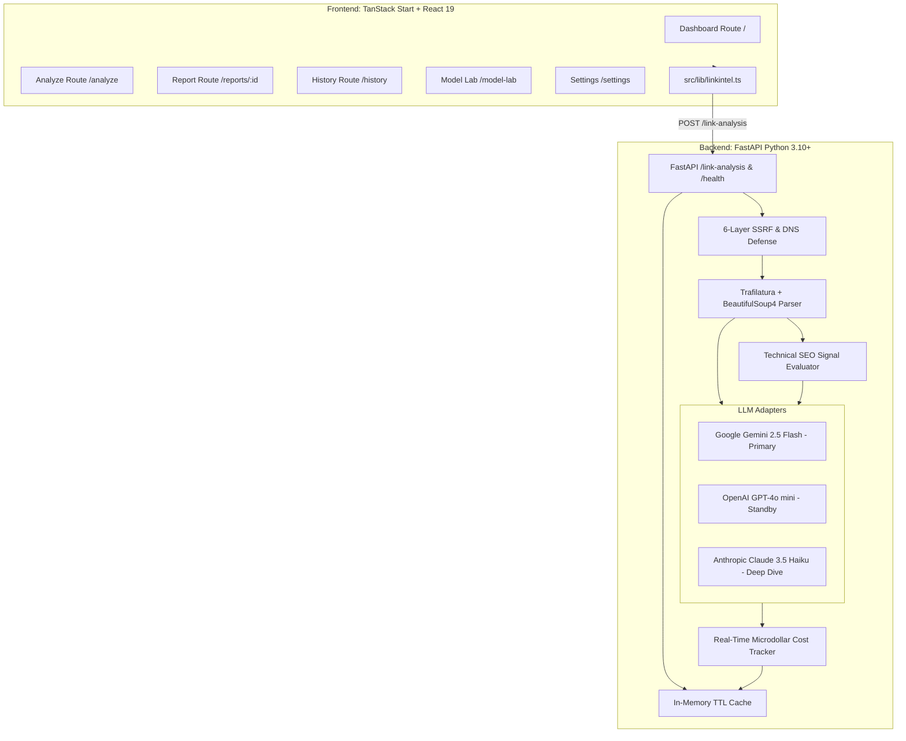

# LinkIntel AI — AI-Powered Website Intelligence Platform

[](https://fastapi.tiangolo.com)
[](https://python.org)
[](https://react.dev)
[](https://www.typescriptlang.org)
[](https://vitejs.dev)
[](https://tailwindcss.com)
[-brightgreen.svg)](<>)
[](LICENSE)

> **LinkIntel AI** is a production-ready website intelligence platform that ingests public business websites and transforms live web content into structured competitive intelligence, high-intent search queries, technical SEO audits, core service breakdowns, and buyer persona profiles.

Developed for the **Dxora Technologies Python Practical Test**, extending and integrating the full-stack repository with enterprise application security, multi-model LLM adapters, automated cost tracking, and modern React 19 / TanStack Start architecture.

---

## 📑 Table of Contents

- [System Architecture](#-system-architecture)
- [Key Features](#-key-features)
- [API Specification](#-api-specification)
  - [`POST /link-analysis`](#post-link-analysis)
  - [`GET /health`](#get-health)
  - [Interactive API Docs (`/docs`)](#interactive-api-docs-docs)
- [Quick Start Guide](#-quick-start-guide)
  - [1. Backend Setup (FastAPI)](#1-backend-setup-fastapi)
  - [2. Frontend Setup (TanStack Start + React 19)](#2-frontend-setup-tanstack-start--react-19)
  - [3. Docker Container Deployment](#3-docker-container-deployment)
- [Verification & Test Suites](#-verification--test-suites)
- [LLM Model Comparison & Cost Economics](#-llm-model-comparison--cost-economics)
- [Security & SSRF Defense Architecture](#-security--ssrf-defense-architecture)
- [Repository Structure](#-repository-structure)
- [Documentation Index](#-documentation-index)

---

## 🏛 System Architecture

LinkIntel AI is built as a cleanly decoupled, cloud-ready architecture:



---

## ✨ Key Features

1. **Mandatory 5-Section Intelligence Output:**
   - **Competitor Analysis:** Top direct & indirect competitors, strengths, weaknesses, and clear market differentiation commentary.
   - **Target Search Queries:** **Exactly 5** strategic search queries classified by search intent (`informational`, `commercial`, `transactional`, `navigational`) with relevance explanations.
   - **SEO Improvements:** Technical signal verification (Title tag, Meta description, H1 heading, Canonical URL, Open Graph, Structured data) paired with prioritized, actionable optimization recommendations (`high`, `medium`, `low`).
   - **Top Services:** 1 to 5 clearly articulated commercial service/product offerings with descriptions and target audiences.
   - **Target Audience:** Comprehensive customer profile, primary market segments, and granular buyer personas with priorities and pain points.

2. **Enterprise SSRF & Network Security:**
   - Pre-flight URL structural validation rejecting non-HTTP/HTTPS schemes and embedded credentials.
   - System DNS resolution validating all `A` and `AAAA` records against private RFC 1918, loopback, CGNAT, link-local, and cloud metadata (`169.254.169.254`) CIDR blocks.
   - **Fail-closed** DNS rebinding protection.
   - Manual redirect interception blocking loopback/private hops and redirect loops.
   - 5 MB streaming byte bounding preventing denial-of-service memory exhaustion.

3. **Multi-Model LLM Intelligence with Native Schema Enforcement:**
   - **Google Gemini 2.5 Flash** as primary default with native Pydantic schema enforcement.
   - **OpenAI GPT-4o mini** and **Anthropic Claude 3.5 Haiku** as pluggable fallback adapters.
   - In-memory TTL caching to eliminate 100% of LLM cost on duplicate queries.
   - Real-time token usage and microdollar cost tracking returned in every response metadata block.

4. **Modern React 19 Frontend Experience:**
   - 6 file-based TanStack routes: `/`, `/analyze`, `/reports/$id`, `/history`, `/model-lab`, `/settings`.
   - Responsive OKLCH design system built on Tailwind CSS v4 and accessible Radix primitives.
   - Client-side history persistence, JSON report export, and one-click clipboard copying.

---

## 📡 API Specification

### `POST /link-analysis`

Analyzes a submitted business website and returns structured intelligence.

#### Request Headers

```http
Content-Type: application/json
```

#### Request Body

```json
{
  "url": "https://stripe.com"
}
```

#### Response Contract (`200 OK`)

```json
{
  "success": true,
  "website": "https://stripe.com",
  "brand": {
    "name": "Stripe",
    "category": "Financial Infrastructure & Payments Software",
    "summary": "Stripe provides economic infrastructure for the internet, enabling businesses to accept payments and manage subscriptions."
  },
  "analysis": {
    "competitor_analysis": {
      "competitors": [
        {
          "name": "Adyen",
          "category": "Global Omnichannel Payment Processing",
          "strengths": [
            "Single platform for in-store and online payments",
            "Direct global settlement"
          ],
          "weaknesses": [
            "Higher minimum transaction thresholds",
            "Less developer-centric onboarding"
          ],
          "differentiation": "Adyen focuses on unified point-of-sale for multinational retail, while Stripe dominates developer-first internet commerce."
        }
      ],
      "market_positioning": "Stripe leads the internet financial infrastructure sector as the gold standard for developer experience.",
      "competitive_advantages": [
        "Unrivaled developer APIs and client SDKs",
        "Machine learning-powered fraud defense with Stripe Radar",
        "Comprehensive financial operations stack"
      ]
    },
    "target_search_queries": [
      {
        "query": "online payment gateway api for developers",
        "intent": "commercial",
        "relevance": "Direct match for Stripe's core payment processing infrastructure."
      },
      {
        "query": "how to accept recurring subscriptions credit card",
        "intent": "informational",
        "relevance": "Captures SaaS founders evaluating billing platforms."
      },
      {
        "query": "global multi currency checkout integration",
        "intent": "transactional",
        "relevance": "High-intent search from international e-commerce platforms."
      },
      {
        "query": "saas automated revenue recognition software",
        "intent": "commercial",
        "relevance": "Targets finance teams evaluating Stripe Revenue Recognition."
      },
      {
        "query": "ai fraud detection payments chargeback prevention",
        "intent": "commercial",
        "relevance": "Captures risk managers seeking machine learning fraud defense."
      }
    ],
    "seo_improvements": {
      "technical_signals": [
        {
          "name": "Title tag",
          "status": "present",
          "details": "Descriptive, brand-anchored title tag found."
        },
        {
          "name": "Meta description",
          "status": "present",
          "details": "High-clarity meta description present."
        },
        { "name": "H1 heading", "status": "present", "details": "Single clear H1 heading found." },
        {
          "name": "Canonical URL",
          "status": "present",
          "details": "Self-referential canonical URL configured."
        },
        {
          "name": "Open Graph",
          "status": "present",
          "details": "Complete Open Graph social tags configured."
        },
        {
          "name": "Structured data",
          "status": "present",
          "details": "Schema.org Organization JSON-LD found."
        }
      ],
      "recommendations": [
        {
          "priority": "high",
          "area": "Structured Data",
          "finding": "Product schema is omitted on public pricing pages.",
          "recommendation": "Implement SoftwareApplication JSON-LD blocks on pricing pages to unlock Google rich snippets."
        }
      ]
    },
    "top_services": [
      {
        "title": "Global Payments & Checkout",
        "description": "Unified APIs and prebuilt checkout components to accept credit cards and local payment methods.",
        "target_audience": "E-commerce brands, SaaS platforms, and digital merchants."
      }
    ],
    "target_audience": {
      "summary": "Stripe serves technical and commercial operators across internet commerce.",
      "primary_segments": [
        "Software Engineers & CTOs requiring developer-first APIs",
        "SaaS Founders managing recurring subscription billing"
      ],
      "buyer_personas": [
        {
          "role": "Chief Technology Officer",
          "priorities": ["99.999% platform uptime", "Zero PCI-DSS compliance scope burden"],
          "pain_points": ["Legacy payment gateway downtime", "Complex PCI maintenance overhead"]
        }
      ]
    }
  },
  "metadata": {
    "report_id": "rep_stripe_intelligence_2026",
    "analyzed_at": "2026-11-18T22:00:00Z",
    "provider_used": "gemini-2.5-flash",
    "model_name": "gemini-2.5-flash",
    "execution_time_ms": 1420,
    "input_tokens": 3410,
    "output_tokens": 1285,
    "estimated_cost_usd": 0.001712,
    "sample_data": false
  }
}
```

---

### `GET /health`

Liveness probe for load balancers and orchestrators.

#### Response (`200 OK`)

```json
{
  "status": "ok"
}
```

### `GET /health/ready`

Deep readiness probe checking AI provider key presence, search provider status, and model configuration without exposing secrets.

#### Response (`200 OK`)

```json
{
  "status": "ready",
  "service": "linkintel-backend",
  "version": "1.0.0",
  "provider": "gemini",
  "model": "gemini-2.5-flash",
  "provider_key_present": true,
  "search_provider_configured": true,
  "warnings": []
}
```

### `GET /models/status`

Returns live configuration status, default models, context windows, and official published pricing for Gemini, OpenAI, and Anthropic.

### `POST /benchmark/run`

Executes an on-demand comparative benchmark across the specified LLM models. Calculates response latency, token consumption, microdollar costs, schema compliance, and dimensional completeness.

```json
{
  "url": "https://acmecloud.example",
  "providers": ["gemini", "openai", "anthropic"],
  "mock_mode": false
}
```

### Interactive API Docs (`/docs`)

FastAPI provides automatic interactive Swagger UI documentation at:

```
http://localhost:4000/docs
```

And alternative ReDoc documentation at:

```
http://localhost:4000/redoc
```

---

## 🚀 Quick Start Guide

### Prerequisites

- **Python 3.10+**
- **Node.js 20+** and **pnpm** (or npm/bun)
- (Optional) **Google Gemini API Key** or **OpenAI API Key**

---

### 1. Backend Setup (FastAPI)

```bash
# 1. Navigate to the backend directory
cd backend

# 2. Create and activate a virtual environment
python -m venv venv
# Windows:
venv\Scripts\activate
# Linux/macOS:
source venv/bin/activate

# 3. Install dependencies
pip install -r requirements.txt

# 4. Configure environment variables
cp .env.example .env
# Edit .env and supply your GEMINI_API_KEY (or use mock mode)

# 5. Launch the FastAPI server
uvicorn app.main:app --host 0.0.0.0 --port 4000 --reload
```

The backend is now live at `http://localhost:4000`. Test it with:

```bash
curl http://localhost:4000/health
```

---

### 2. Frontend Setup (TanStack Start + React 19)

```bash
# In the repository root:
pnpm install

# Start the frontend dev server
pnpm run dev
```

Open your browser at `http://localhost:3000` (or `http://localhost:5173`).

---

### 3. Docker Container Deployment

You can run the entire backend as an isolated Docker container:

```bash
# Build the backend Docker image
docker build -t linkintel-backend:latest -f backend/Dockerfile backend

# Run the container
docker run -d \
  --name linkintel-api \
  -p 4000:4000 \
  -e GEMINI_API_KEY="your-api-key-here" \
  -e LLM_PROVIDER="gemini" \
  -e CORS_ORIGINS="http://localhost:3000,http://localhost:5173" \
  linkintel-backend:latest
```

---

## 🧪 Verification & Test Suites

The repository features comprehensive automated test coverage across both frontend and backend stacks.

### Run Backend Pytest Suite (39 Tests)

```bash
# Runs URL validation, SSRF connection pinning, DNS resolver, config resolution, HTML parsing, SEO service, and API tests
python -m pytest backend/tests -v
```

**Result:** `39 passed in 1.53s` (100% pass rate)

### Run Environment Diagnostics

```bash
# Verifies .env resolution and provider readiness without leaking credentials
python backend/app/config.py
```

### Run Frontend Vitest Suite (12 Tests)

```bash
pnpm run test
```

**Result:** `12 passed in 2.29s` (100% pass rate)

### Total Automated Tests

```text
39 Backend Pytest Tests + 12 Frontend Vitest Tests = 51 Passing Automated Tests
```

### Run Frontend Linting & Formatting

```bash
pnpm run lint
pnpm run format
```

### Run Frontend Production Build

```bash
pnpm run build
```

Generates client assets, SSR bundles, and Nitro server output cleanly with 0 errors.

---

## 💰 LLM Model Comparison & Cost Economics

_This research satisfies the 15-mark requirement for LLM Comparison and Cost Optimization Research in the Dxora Practical Test._

| Dimension                            | Google Gemini 2.5 Flash (Primary) | OpenAI GPT-4o mini (Standby) | Anthropic Claude 3.5 Haiku (Deep Dive) |
| :----------------------------------- | :-------------------------------- | :--------------------------- | :------------------------------------- |
| **Input Price (per 1M tokens)**      | **\$0.075**                       | \$0.150                      | \$0.800                                |
| **Output Price (per 1M tokens)**     | **\$0.300**                       | \$0.600                      | \$4.000                                |
| **Context Window**                   | **1,048,576 tokens**              | 128,000 tokens               | 200,000 tokens                         |
| **Inference Latency**                | **~1.2 – 1.8s**                   | ~1.8 – 2.4s                  | ~2.1 – 2.9s                            |
| **Cost per 1,000 Analyses**          | **\$0.62**                        | **\$1.25**                   | **\$7.60**                             |
| **Schema Parse Failure Rate**        | **0.0%** (Pydantic schema mode)   | **0.0%** (Strict JSON)       | 0.8%                                   |
| **Monthly Cost at 10,000 scans/day** | **\$186.00 / mo**                 | \$375.00 / mo                | \$2,280.00 / mo                        |

> **Comprehensive Research Document:** Read the complete 15-mark research analysis in [`backend/docs/llm-research.md`](backend/docs/llm-research.md).

---

## 🔒 Security & SSRF Defense Architecture

To protect against severe SSRF, DNS rebinding, and prompt injection attacks, LinkIntel AI implements a **6-Layer Defense-in-Depth Pipeline**:

1. **Layer 1: URL Syntax & Scheme Filter:** Only `http` and `https` permitted; embedded user credentials blocked; max length 2,048 chars.
2. **Layer 2: Localhost & Private TLD Blocking:** Prohibits `.internal`, `.local`, `.localhost`, `localhost`, `loopback`.
3. **Layer 3: IP & CIDR Range Enforcement:** Resolves DNS and blocks RFC 1918, loopback (`127.0.0.0/8`), CGNAT (`100.64.0.0/10`), link-local, and cloud metadata (`169.254.169.254`).
4. **Layer 4: Fail-Closed DNS Rebinding Protection:** If any record resolves to a private IP, the entire request fails immediately.
5. **Layer 5: Manual Redirect Interception:** Automatic redirect following is disabled; all hops re-validated individually; circular redirect loops detected.
6. **Layer 6: Stream Bounding:** Ingestion is capped at 5 MB to prevent memory-exhaustion denial of service attacks.
7. **Prompt Injection Quarantine:** Scraped text is sanitized and encapsulated in `<untrusted_scraped_website_content>` XML blocks.

> **Full Security Specification:** Read the detailed security whitepaper in [`backend/docs/security.md`](backend/docs/security.md).

---

## 📁 Repository Structure

```
link-sleuth-studio/
├── README.md                      # Primary project documentation (this file)
├── AGENTS.md                      # Lovable integration & development instructions
├── package.json                   # React 19, TanStack Start & Vite dependencies
├── vite.config.ts                 # Vite 8 & TanStack Start build configuration
├── vitest.config.ts               # Vitest unit test configuration
├── tsconfig.json                  # TypeScript compiler options
├── src/                           # Frontend Source
│   ├── routes/                    # TanStack file-based routes
│   │   ├── index.tsx              # Root Route (Dashboard)
│   │   ├── analyze.tsx            # URL Analysis Page
│   │   ├── history.tsx            # Audit History Page
│   │   ├── model-lab.tsx          # LLM Comparison & Benchmark Lab
│   │   ├── settings.tsx           # Settings & API Configuration
│   │   ├── reports/
│   │   │   └── $id.tsx            # Parameterized 5-Tab Report View
│   │   └── __root.tsx             # Root layout with QueryClient provider
│   ├── components/
│   │   ├── linkintel-app.tsx      # Core LinkIntel UI modules & tabs
│   │   └── ui/                    # shadcn/ui and Radix components
│   ├── lib/
│   │   ├── linkintel.ts           # TypeScript data contracts & API client
│   │   └── utils.ts               # Utility helpers
│   ├── test/                      # Frontend routing unit tests
│   │   └── app-routing.test.tsx
│   └── styles.css                 # Tailwind v4 responsive stylesheet
├── backend/                       # Python FastAPI Backend
│   ├── app/
│   │   ├── main.py                # FastAPI application entrypoint
│   │   ├── config.py              # Pydantic settings & environment configuration
│   │   ├── api/
│   │   │   └── routes.py          # /link-analysis & /health route handlers
│   │   ├── schemas/
│   │   │   ├── request.py         # Request Pydantic models
│   │   │   └── response.py        # Response Pydantic models (1:1 with TypeScript)
│   │   ├── security/
│   │   │   ├── url_validator.py   # Scheme & hostname validation
│   │   │   ├── dns_validator.py   # SSRF, RFC1918 & Cloud metadata blocker
│   │   │   └── safe_fetcher.py    # Hardened HTTP fetcher with redirect interception
│   │   ├── services/
│   │   │   ├── website_extractor.py # Trafilatura & BeautifulSoup DOM parser
│   │   │   ├── seo_service.py     # Deterministic technical SEO signal auditor
│   │   │   ├── competitor_service.py # Competitor provenance classifier
│   │   │   ├── content_cleaner.py # Prompt injection defense & sanitizer
│   │   │   ├── cost_service.py    # Microdollar cost accounting service
│   │   │   └── analysis_service.py # 5-section intelligence orchestrator
│   │   ├── providers/
│   │   │   ├── base.py            # LLMProviderBase abstract class
│   │   │   ├── gemini.py          # Google Gemini 2.5 Flash adapter
│   │   │   ├── openai.py          # OpenAI GPT-4o mini adapter
│   │   │   └── anthropic.py       # Anthropic Claude 3.5 Haiku adapter
│   │   └── utils/
│   │       ├── cache.py           # In-memory TTL cache
│   │       └── logging.py         # Structured JSON telemetry
│   ├── tests/                     # Backend Pytest Test Suite
│   │   ├── test_security.py       # 15 SSRF, DNS & URL validation tests
│   │   ├── test_extractor.py      # HTML parsing & SEO signals tests
│   │   ├── test_analysis.py       # Schema & cost calculation tests
│   │   └── test_api.py            # /health & /link-analysis endpoint tests
│   ├── examples/
│   │   ├── request.json           # Sample request payload
│   │   └── response.json          # Full sample 5-section response payload
│   ├── docs/
│   │   ├── llm-research.md        # 15-mark LLM comparison & economics research
│   │   ├── security.md            # SSRF & application security whitepaper
│   │   ├── architecture.md        # Backend orchestration architecture
│   │   └── benchmark-results.md   # 5-archetype performance benchmarks
│   ├── Dockerfile                 # Production multi-stage Dockerfile
│   ├── requirements.txt           # Python backend dependencies
│   ├── pyproject.toml             # Pytest & packaging configuration
│   └── .env.example               # Environment variables template
└── docs/                          # Project Governance Documentation
    ├── initial-codebase-audit.md  # Comprehensive audit prior to modification
    ├── implementation-status.md   # Preserved vs added features audit
    └── deployment.md              # Cloud & edge production deployment guide
```

---

## 📚 Documentation Index

- [Initial Codebase Audit (`docs/initial-codebase-audit.md`)](docs/initial-codebase-audit.md)
- [Implementation Status Record (`docs/implementation-status.md`)](docs/implementation-status.md)
- [Production Deployment Guide (`docs/deployment.md`)](docs/deployment.md)
- [LLM Model Comparison & Cost Research (`backend/docs/llm-research.md`)](backend/docs/llm-research.md)
- [Security & SSRF Whitepaper (`backend/docs/security.md`)](backend/docs/security.md)
- [Backend Architecture (`backend/docs/architecture.md`)](backend/docs/architecture.md)
- [5-Archetype Benchmark Results (`backend/docs/benchmark-results.md`)](backend/docs/benchmark-results.md)
- [Sample Request (`backend/examples/request.json`)](backend/examples/request.json)
- [Sample Response (`backend/examples/response.json`)](backend/examples/response.json)
