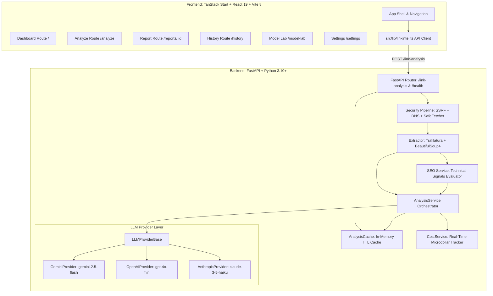
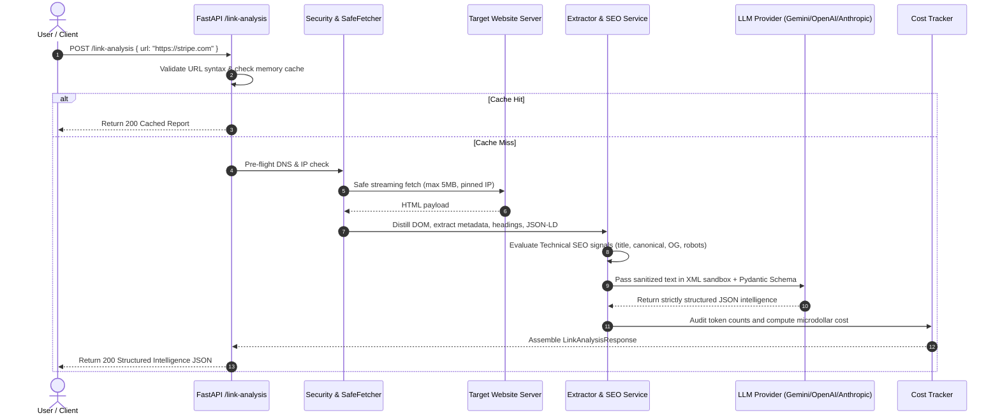

# LinkIntel AI System Architecture

**Document Version:** 1.0  
**Status:** Implemented & Production Ready  
**Repository:** `link-sleuth-studio` → `LinkIntel AI`  

---

## 1. High-Level Architecture

LinkIntel AI is engineered as a decoupled, full-stack website intelligence platform consisting of a high-performance **TanStack Start (React 19)** frontend client and an enterprise **Python 3.10+ FastAPI** backend orchestration engine.

---

## 2. Frontend Layer (`src/`)

### 2.1 Framework & Core Dependencies
- **React 19 & TypeScript:** State-of-the-art type-safe user interface components.
- **Vite 8 & TanStack Start:** Modern SSR and client bundling with Nitro cloud deployment presets.
- **TanStack Router:** Type-safe, file-based routing architecture (`src/routes/` and generated `src/routeTree.gen.ts`).
- **TanStack React Query:** Asynchronous request caching, loading states, and mutations.
- **Tailwind CSS v4 & shadcn/ui:** Native OKLCH semantic color palette, responsive layout grids, and accessible Radix UI primitives.

### 2.2 File-Based Route Topology
1. `/` (`src/routes/index.tsx`): Root executive dashboard displaying active system status, recent audits, quick-scan input, and platform capabilities.
2. `/analyze` (`src/routes/analyze.tsx`): Full website analysis form with real-time domain validation, provider switching, and progress indicators.
3. `/reports/$id` (`src/routes/reports/$id.tsx`): Interactive 5-tab intelligence report covering Competitors, Search Queries, Technical SEO, Services, and Target Audience.
4. `/history` (`src/routes/history.tsx`): Persistent browser audit log with local search, filtering, and export capabilities.
5. `/model-lab` (`src/routes/model-lab.tsx`): Model comparison workbench, token economics calculator, and provider latency benchmarks.
6. `/settings` (`src/routes/settings.tsx`): Configuration panel for API Base URL (`http://localhost:4000`), local data clearing, and preferences.

---

## 3. Backend Orchestration Pipeline (`backend/app/`)

### 3.1 Execution Flow

### 3.2 Key Components
- **`app/security/url_validator.py`:** Pre-flight URL structural validation, scheme enforcement, credential rejection, and local/private TLD filtering.
- **`app/security/dns_validator.py`:** System DNS resolution verifying all `A` and `AAAA` records against prohibited private/cloud CIDR ranges with a fail-closed policy.
- **`app/security/safe_fetcher.py`:** Hardened HTTP client with disabled auto-redirects, manual hop verification, loop detection, and 5MB stream capping.
- **`app/services/website_extractor.py`:** Dual-mode extraction leveraging `trafilatura` for clean editorial copy and `BeautifulSoup4` for metadata, headings, canonical links, schema.org JSON-LD, and image alt text.
- **`app/services/seo_service.py`:** Deterministic technical audit engine evaluating title length, meta description quality, H1 count, canonical tag match, schema validity, and social graph readiness.
- **`app/providers/base.py`:** Abstract base class defining `generate_analysis()` contract across all models.
- **`app/providers/gemini.py`:** Google Gemini 2.5 Flash implementation using official `google-genai` SDK with native JSON schema enforcement.
- **`app/providers/openai.py`:** OpenAI GPT-4o mini adapter using `response_format={"type": "json_object"}`.
- **`app/providers/anthropic.py`:** Claude 3.5 Haiku adapter utilizing tool-use schema structuring.
- **`app/services/cost_service.py`:** Exact micro-dollar cost calculator accounting for prompt and completion token rates.
- **`app/utils/cache.py`:** High-throughput in-memory TTL cache with clean URL key normalization.

---

## 4. Contract Parity: TypeScript ↔ Pydantic

The backend response model strictly matches the frontend TypeScript interface:

| Field Path | TypeScript Type (`src/lib/linkintel.ts`) | Python Pydantic Model (`backend/app/schemas/`) |
| :--- | :--- | :--- |
| `success` | `boolean` | `bool` |
| `website` | `string` | `HttpUrl` / `str` |
| `brand.name` | `string` | `str` |
| `brand.category` | `string` | `str` |
| `brand.summary` | `string` | `str` |
| `analysis.competitor_analysis` | `CompetitorAnalysis` | `CompetitorAnalysis` |
| `analysis.target_search_queries` | `SearchQuery[]` (length: 5) | `List[SearchQuery]` (min: 5, max: 5) |
| `analysis.seo_improvements` | `SeoImprovements` | `SeoImprovements` |
| `analysis.top_services` | `ServiceInsight[]` (1-5) | `List[ServiceInsight]` (min: 1, max: 5) |
| `analysis.target_audience` | `AudienceProfile` | `AudienceProfile` |
| `metadata.report_id` | `string` | `str` |
| `metadata.analyzed_at` | `string` | `str` |
| `metadata.provider_used` | `string` | `str` |
| `metadata.execution_time_ms`| `number` | `int` |
| `metadata.estimated_cost_usd`| `number` | `float` |
| `metadata.sample_data` | `boolean` | `bool` |
