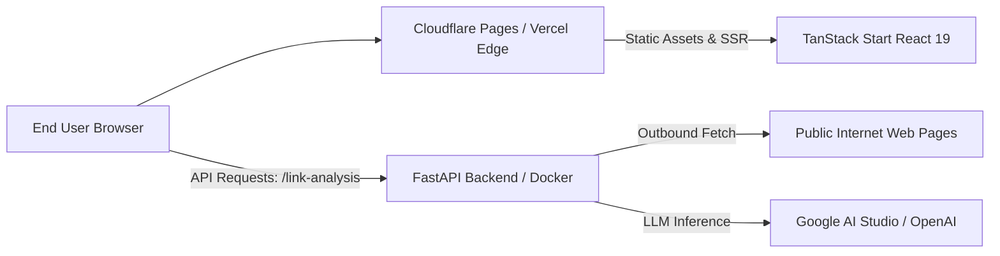

# LinkIntel AI Production Deployment Guide

**Document Version:** 1.0  
**Target Environments:** Cloud Containers (Docker), PaaS (Render / Railway / Fly.io / AWS ECS), Serverless Edge (Vercel / Cloudflare Pages / Netlify)  

---

## 1. Architecture & Deployment Topology

LinkIntel AI is designed to deploy cleanly as two decoupled services:
1. **Backend Service:** FastAPI Python application running inside a lightweight Docker container or Python 3.10+ runtime, handling SSRF-protected link fetching and LLM orchestration.
2. **Frontend Service:** TanStack Start React 19 application built via Vite and Nitro, deploying to edge networks (Vercel, Cloudflare, Netlify) or containerized with Node.js.



---

## 2. Environment Variables Specification

### 2.1 Backend Environment Variables (`backend/.env`)

| Variable Name | Required? | Default Value | Description |
| :--- | :--- | :--- | :--- |
| `GEMINI_API_KEY` | **Yes** (if provider=gemini) | `""` | Google Gemini API key from AI Studio |
| `OPENAI_API_KEY` | Optional | `""` | OpenAI API key for `gpt-4o-mini` fallback |
| `ANTHROPIC_API_KEY` | Optional | `""` | Anthropic API key for `claude-3-5-haiku` |
| `LLM_PROVIDER` | No | `"gemini"` | Active provider: `gemini`, `openai`, `anthropic`, or `mock` |
| `GEMINI_MODEL` | No | `"gemini-2.5-flash"` | Gemini model identifier |
| `OPENAI_MODEL` | No | `"gpt-4o-mini"` | OpenAI model identifier |
| `PORT` | No | `4000` | Local or container listener port |
| `HOST` | No | `"0.0.0.0"` | Network binding interface |
| `CORS_ORIGINS` | No | `http://localhost:3000,http://localhost:5173` | Comma-separated list of permitted frontend origins |
| `CACHE_TTL_SECONDS`| No | `3600` | In-memory cache duration for audited websites (1 hour) |
| `MAX_CONTENT_BYTES`| No | `5242880` | Maximum response payload size for web extraction (5 MB) |
| `ENVIRONMENT` | No | `"production"` | Environment mode: `production` or `development` |

### 2.2 Frontend Environment Variables (`.env.production`)

| Variable Name | Required? | Default Value | Description |
| :--- | :--- | :--- | :--- |
| `VITE_API_BASE_URL` | No | `http://localhost:4000` | Base URL of deployed FastAPI backend service |

---

## 3. Containerized Backend Deployment (Docker)

The repository provides a production multi-stage Dockerfile located at `backend/Dockerfile`.

### 3.1 Build & Run Locally with Docker
```bash
# 1. Build Docker image
docker build -t linkintel-backend:latest -f backend/Dockerfile backend

# 2. Run container with credentials
docker run -d \
  --name linkintel-api \
  -p 4000:4000 \
  -e GEMINI_API_KEY="AIzaSy..." \
  -e LLM_PROVIDER="gemini" \
  -e CORS_ORIGINS="https://linkintel.yourdomain.com,http://localhost:3000" \
  linkintel-backend:latest
```

### 3.2 Verify Running Container
```bash
# Health check
curl -f http://localhost:4000/health
# Response: {"status":"ok","timestamp":"...","version":"1.0.0","service":"LinkIntel AI"}

# Interactive OpenAPI docs
# Open browser at http://localhost:4000/docs
```

---

## 4. Cloud Platform Deployment Recipes

### 4.1 Deploying Backend to Render.com
1. Create a **New Web Service** connected to your GitHub repository.
2. Set **Root Directory** to `backend`.
3. Set **Runtime** to `Python 3`.
4. Set **Build Command:**
   ```bash
   pip install --upgrade pip && pip install -r requirements.txt
   ```
5. Set **Start Command:**
   ```bash
   uvicorn app.main:app --host 0.0.0.0 --port $PORT
   ```
6. Add Environment Secrets in the Render dashboard:
   - `GEMINI_API_KEY`: `<your_api_key>`
   - `LLM_PROVIDER`: `gemini`
   - `CORS_ORIGINS`: `https://<your-frontend-app>.vercel.app`
7. Set Health Check path to `/health`.

### 4.2 Deploying Backend to Railway.app
1. From the Railway dashboard, select **Deploy from GitHub repo**.
2. Set root directory to `/backend`.
3. Railway automatically detects `backend/Dockerfile`.
4. Add environment variables in Railway settings (`GEMINI_API_KEY`, `CORS_ORIGINS`).
5. Configure public networking domain and port `4000`.

### 4.3 Deploying Frontend to Vercel / Cloudflare Pages
The frontend uses standard Vite and TanStack Start Nitro output.

#### Deploy via Vercel:
1. Connect your repository to Vercel.
2. Root directory: `./` (root).
3. Framework Preset: **Other / Vite**.
4. Build Command: `pnpm run build`
5. Output Directory: `.output/public`
6. Environment Variables:
   - `VITE_API_BASE_URL`: `https://<your-deployed-backend-service>.onrender.com`

---

## 5. Security & Egress Hardening in Production

1. **SSRF Guardrails:** The backend includes full RFC1918, CGNAT, loopback, and cloud metadata blocking (`dns_validator.py` and `safe_fetcher.py`).
2. **Cloud Metadata Defense:** In AWS, enable **IMDSv2** with hop limit = 1 to prevent metadata token access even in misconfigured containers.
3. **CORS Whitelisting:** Ensure `CORS_ORIGINS` in production explicitly restricts origins to your verified frontend domain rather than wildcard `*`.
4. **Rate Limiting:** Deploy Cloudflare or a reverse proxy (e.g. Nginx or Traefik) in front of the FastAPI backend with rate limiting rules (e.g. 60 requests/minute per client IP).
